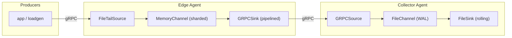

# logflow

A distributed log aggregator in Go, modeled on Apache Flume's
source → channel → sink architecture, built on gRPC + Protocol Buffers.



Any number of these agents can be chained: a sink in one agent is a gRPC
client of the next agent's source, exactly like Flume's Avro source/sink
pairing. Each agent is independently configured via YAML and can mix and
match source/channel/sink types.

## Components

**Sources** (`internal/source`)
- `GRPCSource` — implements the `Collector` gRPC service. Accepts a
  bidirectional streaming RPC (`StreamEvents`) so a well-behaved client can
  pipeline many batches without a round trip per batch, plus a unary
  `SendBatch` for simple/low-volume producers. Used both for external
  ingestion and for agent-to-agent forwarding.
- `FileTailSource` — follows a growing/rotating file like `tail -F`.

Every source runs its events through an **interceptor chain** and then a
**channel selector** before they're considered received — see below.

**Interceptors** (`internal/interceptor`)

A source can declare an ordered list of interceptors that transform or
filter every event before it's routed to a channel. Built-ins:

| type              | does |
|-------------------|------|
| `timestamp`       | stamps a header with ingest time (ms since epoch); `preserve_existing` skips events that already have it |
| `host`            | tags the event with the agent's hostname (or IP with `use_ip: true`) |
| `static`          | adds a fixed `key`/`value` header |
| `regex_filter`    | drops events whose body matches (or, with `exclude: true`, doesn't match) a pattern |
| `regex_extractor` | promotes regex capture groups from the body into headers, by name (`(?P<name>...)`) or 1-based index |

New interceptor types are added by implementing one `Intercept(*Event) *Event`
method (return `nil` to drop) — the config schema (`type` + a string-keyed
`params` map) never has to change.

**Channel Selectors** (`internal/router`)

A source can target more than one channel via `channels: [...]` plus a
`selector`:
- `replicating` (default when more than one channel is listed) — every
  event goes to every listed channel.
- `multiplexing` — routes by the value of one header: `mapping` maps header
  values to a list of destination channels, `default` catches everything
  else. This is how you'd split one firehose into per-tenant, per-priority,
  or per-destination channels.

**Channels** (`internal/channel`)
- `MemoryChannel` — bounded, **sharded** in-memory queue. Producers hash
  across N independent Go channels instead of funneling through one shared
  queue, reducing lock contention under many concurrent goroutines; a fair
  fan-in read uses `reflect.Select` across all shards. Fast, but not
  durable — a crash loses whatever's buffered.
- `FileChannel` — a real **write-ahead log**: events are appended to disk
  (flushed immediately, fsynced on a timer) and only exposed to consumers
  once durably written. Segments roll at a configurable size and are
  deleted once fully drained. On restart it replays whatever segment files
  remain on disk. Every entry carries a CRC32 checksum; recovery stops
  replaying a segment at the first entry that fails verification rather
  than risking a torn write (or genuine bit rot) cascading into garbage.
  Delivery is **at-least-once**: a crash between "consumed" and "segment
  fully drained" can replay already-delivered events — this is the same
  trade-off Flume's file channel makes, and downstream consumers should be
  idempotent or dedupe if that matters.

  Segment cleanup happens two ways. The common path is reactive: a segment
  is deleted the moment its last entry is taken, as a normal side effect
  of consumption. The backstop is an **active retention sweep** enforcing
  an optional `RetentionPolicy` (`retention_max_age` / `retention_max_bytes`,
  swept every `compaction_interval`) - independent of whether consumers
  have caught up at all. A segment past its retention limit is purged even
  if it still holds unconsumed entries, the same trade-off Kafka's
  `retention.ms`/`retention.bytes` make: a retention limit describes how
  long you're willing to keep data, period, separate from whether it's
  been delivered. Purged-but-still-unconsumed events are counted via
  `PurgedUnconsumed()` (surfaced in `/stats` as `purged_unconsumed`) so
  it's visible when this is actually discarding data versus just
  reclaiming already-delivered space.
- `SpillableMemoryChannel` (`type: spillable`) — Flume's other durability
  pattern: a fast `MemoryChannel` primary with automatic overflow to a
  durable `FileChannel` once the primary fills, rather than blocking or
  dropping. `Take()` drains the overflow with priority, since anything
  sitting there means the system was already falling behind. Reports a
  `Spilled()` counter (surfaced in `/stats`) as a signal that downstream
  consumers aren't keeping up. The same `RetentionPolicy` can be applied
  to its overflow.

**Sinks** (`internal/sink`)
- `GRPCSink` — drains a channel, batches events (by count or a linger
  timeout, whichever comes first), and forwards them over a streaming RPC.
  Runs several worker goroutines (`parallelism`) each holding its own
  stream, and each worker keeps several batches in flight
  (`in_flight_batches`) rather than waiting for an ack before sending the
  next one. Supports gzip compression, automatic reconnect with backoff,
  and requeues events back onto the channel on send failure.
- `FileSink` — appends batches as newline-delimited text to files that roll
  by size or time.
- `StdoutSink` / `NullSink` — for local testing.

**Sink Processors / groups** (`internal/sink`, configured under
`sink_groups` instead of `sinks`)

A group of gRPC backends draining one channel, coordinated by a policy:
- `load_balance` — every backend is active simultaneously; `parallelism`
  workers each bind to one target (`round_robin`, wrapping if there are
  more workers than targets, or `random`), all pulling concurrently from
  the same channel. A target being down only removes that fraction of
  capacity.
- `failover` — exactly one backend is active at a time, chosen by priority
  (`targets[0]` first). On failure it's marked down and traffic moves to
  the next available target; a background prober `Ping`s every
  higher-priority target every `recovery_probe_interval` and promotes one
  back the moment it responds, by cancelling the active stream so the
  drain loop reconnects immediately rather than waiting for the current
  target to fail on its own.

**Agent** (`internal/agent`) wires up sources/interceptors/selectors/
channels/sinks/sink-groups from a `config.Config` and exposes `/metrics`
(Prometheus text format), `/healthz`, and `/stats` over HTTP.

## Encryption and security

Every gRPC endpoint (source or sink) is unencrypted, unauthenticated
plaintext by default — the same "secure is opt-in" stance as the rest of
this project. Turn on either or both of two independent layers per
endpoint via `internal/security`:

**TLS / mutual TLS** — set `tls.enabled: true` under a source, sink, or
sink group:

```yaml
tls:
  enabled: true
  cert_file: certs/server-cert.pem   # this endpoint's own identity
  key_file: certs/server-key.pem
  client_auth: true                  # server only: require+verify a client cert (mTLS)
  ca_file: certs/ca-cert.pem         # server: CA that signs client certs; client: CA that signs the server cert
```

On a sink/sink-group (client role), also set `cert_file`/`key_file` if the
server requires a client certificate (mTLS), and optionally `server_name`
(override the hostname used for certificate verification, e.g. when
`target_addr` is a bare IP) or `insecure_skip_verify: true` (skip server
certificate verification — local testing only, never on an untrusted
network).

**Bearer token auth** — set `auth_token` on a source (the exact string
every caller must present) and the matching `auth_token` on whatever
sink/sink-group talks to it. This is checked independently of TLS via gRPC
metadata, using a constant-time comparison, so it composes with or without
encryption — though without TLS the token itself travels in clear text, so
`grpc-go` refuses to send it over a plaintext connection unless the client
config's TLS is enabled (see `RequireTLS` in `internal/security`).

Generate a throwaway CA + server + client certificate for local testing:

```sh
./scripts/gen-certs.sh   # writes certs/{ca,server,client}-{cert,key}.pem
```

`configs/secure-standalone.yaml` (mTLS + token on a single agent's
ingestion source) and `configs/secure-collector-agent.yaml` /
`configs/secure-edge-agent.yaml` (mTLS + token on an agent-to-agent hop)
are ready-to-run examples — see "Verified behavior" below for exactly what
was exercised against them.

`cmd/loadgen` has matching flags (`-tls`, `-cacert`, `-cert`, `-key`,
`-server-name`, `-insecure-skip-verify`, `-token`) so it can drive a
TLS/mTLS/token-protected agent directly.

## Graceful shutdown and controlled draining

Shutdown is a staged drain, not an instant kill, on the first SIGINT or
SIGTERM:

1. **Stop ingestion.** Sources are cancelled immediately - gRPC sources
   `GracefulStop()` (refuse new streams, let any RPC already in flight
   finish naturally rather than severing it), `filetail` sources stop
   polling. No new events are admitted from this point on.
2. **Drain.** Sinks keep running against whatever's already buffered in
   channels, polling every 100ms, until every channel reports empty or
   the agent's `drain_timeout` (default 30s) elapses - whichever comes
   first. The HTTP server (and `/stats`) stays up through this stage so
   you can watch progress.
3. **Stop sinks and close.** Sinks are cancelled, the HTTP server is shut
   down, and every channel is closed.

Each stage logs what it's doing and how it concluded (fully drained vs.
timed out with N events left, etc). A **second** SIGINT/SIGTERM at any
point during this sequence forces an immediate stop instead of waiting
out the current stage's timeout - the conventional "I understand this may
lose buffered data, stop now" escape hatch, for a source stuck waiting on
a slow producer or a drain that's taking longer than you want to wait for.

`drain_timeout` is set per agent (top-level config, alongside `agent_id`).

## High-performance features

- Bidirectional gRPC streaming with per-worker pipelining (multiple batches
  in flight, not send-wait-send-wait)
- Sharded memory channel to cut lock contention across many goroutines
- Configurable batching (size + linger) at both source and sink boundaries
- Optional gzip compression on the wire
- Bounded channels provide real backpressure (`Put` blocks / respects
  context) instead of unbounded queues that can OOM an agent
- Parallel sink workers per channel, and parallel/priority-ordered
  backends via sink groups (load balance / failover)
- Async batch acking (ack for batch N doesn't block batch N+1 from sending)
- Durable file channel with immediate flush + timed fsync, so durability
  doesn't require fsync-per-event, and per-segment (not per-channel)
  locking so a slow fsync doesn't stall unrelated writers
- Spillable memory channel: fast in-memory path for the common case,
  automatic durable overflow under burst instead of blocking or dropping
- CRC32-verified WAL entries with bounded-allocation recovery, so a torn
  write or on-disk corruption is caught and safely truncated rather than
  crashing the process or replaying garbage
- Automatic reconnect + exponential-ish backoff on downstream failures,
  with best-effort requeue instead of silent data loss
- In-flight interceptor chain (filter/enrich/tag) and channel selectors
  (replicating/multiplexing fan-out) for routing without extra hops
- Zero-copy-oriented I/O throughout the pipeline: an event's body bytes
  are shared by reference (never duplicated) from gRPC ingestion through
  channel routing, replication fan-out, and sink forwarding; the file
  channel additionally pools its write-side encode buffer (`sync.Pool`)
  and aliases the read-side decode buffer directly into the returned
  `Event` instead of copying it - see "Verified behavior" for measured
  before/after allocation numbers
- Graceful, staged shutdown: on SIGINT/SIGTERM, sources stop admitting new
  events first, then sinks keep draining whatever's already buffered until
  every channel is empty or `drain_timeout` elapses, and only then are
  sinks stopped and channels closed - a second signal during that drain
  forces an immediate quit instead of waiting it out

## Building

This repo vendors nothing and expects normal Go module resolution
(`proxy.golang.org` reachable). From the repo root:

```sh
go build ./...
```

If you regenerate `proto/logflow.proto`, you'll need `protoc`,
`protoc-gen-go`, and `protoc-gen-go-grpc` on your `PATH`:

```sh
protoc --go_out=gen/logflowpb --go_opt=paths=source_relative \
       --go-grpc_out=gen/logflowpb --go-grpc_opt=paths=source_relative \
       -I proto proto/logflow.proto
```

## Running

Quick single-agent smoke test:

```sh
go run ./cmd/agent -config configs/standalone.yaml &
go run ./cmd/loadgen -addr 127.0.0.1:6000 -rate 20000 -batch 500 -duration 10s
curl localhost:9100/stats
```

Two-tier topology (edge agent tailing a file, forwarding to a collector
agent that persists to disk):

```sh
go run ./cmd/agent -config configs/collector-agent.yaml &
go run ./cmd/agent -config configs/edge-agent.yaml &
echo "hello world" >> /var/log/app/app.log
curl localhost:9101/stats   # collector
curl localhost:9100/stats   # edge
```

`configs/*.yaml` document every tunable (batch size/linger, parallelism,
in-flight batches, retry/backoff, channel capacity/shards, WAL segment
size, roll policy, etc).

Interceptors + multiplexing selector + a load-balance sink group, all in
one agent, with two receiving backends:

```sh
go run ./cmd/agent -config configs/backend-a.yaml &
go run ./cmd/agent -config configs/backend-b.yaml &
go run ./cmd/agent -config configs/multiplex-demo.yaml &
go run ./cmd/loadgen -addr 127.0.0.1:6000 -rate 5000 -batch 100 -duration 5s
curl localhost:9100/stats   # events split between the `prod` and `default` channels
curl localhost:9200/stats   # backend-a's share of the load-balanced prod traffic
curl localhost:9201/stats   # backend-b's share
```

Failover sink group — kill and restart `backend-a` while traffic is
flowing and watch `configs/failover-demo.yaml`'s log switch to
`backend-b`, then promote `backend-a` back the moment it's reachable
again:

```sh
go run ./cmd/agent -config configs/backend-a.yaml &
go run ./cmd/agent -config configs/backend-b.yaml &
go run ./cmd/agent -config configs/failover-demo.yaml &
go run ./cmd/loadgen -addr 127.0.0.1:6000 -rate 1000 -batch 25 -duration 30s
# in another shell: kill -9 <backend-a pid>, watch it fail over, then
# restart backend-a and watch it get promoted back within recovery_probe_interval
```

TLS + mutual TLS + bearer token, both for direct ingestion and for an
agent-to-agent hop:

```sh
./scripts/gen-certs.sh
go run ./cmd/agent -config configs/secure-standalone.yaml &
go run ./cmd/loadgen -addr 127.0.0.1:6000 -rate 5000 -batch 100 -duration 5s \
  -tls -cacert certs/ca-cert.pem -cert certs/client-cert.pem -key certs/client-key.pem \
  -token s3cret-demo-token
curl localhost:9100/stats   # events landed
# omit -cert/-key to see the mTLS rejection, or pass -token wrong-token to
# see the auth rejection - both fail closed with 0 events landing
```

Spillable memory channel — a tiny in-memory primary with a slow sink
forces most of the burst to overflow to disk; watch the `spilled` counter
climb in `/stats` while `dropped` stays at 0:

```sh
go run ./cmd/agent -config configs/spillable-demo.yaml &
go run ./cmd/loadgen -addr 127.0.0.1:6000 -rate 20000 -batch 500 -duration 5s
curl localhost:9100/stats   # e.g. put=104475 take=104475 dropped=0 spilled=98392
ls data/spillable-demo/overflow/   # the durable WAL holding the spilled backlog
```

Graceful shutdown — start a long-running producer, send SIGTERM once to
watch the staged drain, or twice in quick succession to force an
immediate quit instead:

```sh
go run ./cmd/agent -config configs/shutdown-test.yaml &
AGENT_PID=$!
go run ./cmd/loadgen -addr 127.0.0.1:6000 -rate 20000 -batch 500 -duration 30s &
sleep 1
kill -TERM $AGENT_PID        # first signal: graceful drain begins
# watch the log; send a second signal to force an immediate stop instead:
# kill -TERM $AGENT_PID
```

Active WAL retention/purging — tiny segments and a 3-second retention
window with no sink attached, so nothing is ever consumed and every purge
visibly discards unconsumed data:

```sh
go run ./cmd/agent -config configs/retention-demo.yaml &
go run ./cmd/loadgen -addr 127.0.0.1:6000 -rate 2000 -batch 100 -duration 2s
ls data/retention-demo/wal/ | wc -l   # many segments right after the burst
sleep 4
ls data/retention-demo/wal/ | wc -l   # down to just the active segment
curl localhost:9100/stats             # purged_unconsumed=... in the output
```

## Verified behavior

This was built and exercised end-to-end in a sandboxed environment
(Go 1.22, dependencies fetched directly from GitHub source since the
module proxy was blocked there — a normal machine just needs
`go build ./...`):

- Standalone agent sustained **~19,900 events/sec** end-to-end
  (loadgen → gRPC source → sharded memory channel → sink) with zero drops
  over a 5s / ~100k event run.
- Two-tier edge→collector forwarding over gRPC verified with zero data
  loss under normal operation.
- Crash recovery of the durable file channel verified: killing the
  collector agent mid-flight (`SIGKILL`) and restarting it replayed the
  unconsumed backlog with no data loss (and, as documented above, replayed
  the tail of the already-consumed-but-undeleted active segment, matching
  the documented at-least-once guarantee).
- Multiplexing channel selector verified: events tagged `env=prod` were
  routed exclusively to the `prod` channel (0 landed in `default`), and
  untagged events landed exclusively in `default` (0 in `prod`).
- Load-balance sink group verified: 3,000 events split across two
  independent backend agents (802 / 2,198 — uneven but confirming both
  were genuinely receiving traffic concurrently).
- Failover sink group verified through a full cycle: traffic flowed
  through the priority-0 target only; killing that process mid-stream
  (`SIGKILL`) triggered failover to the priority-1 target with zero events
  lost (all subsequent traffic landed on the backup); restarting the
  priority-0 target triggered automatic promotion back to it within one
  `recovery_probe_interval`, confirmed by post-recovery traffic landing on
  the primary again.
- TLS/mTLS/token auth verified through four scenarios against a source
  configured with `client_auth: true` + `auth_token` set: a plaintext
  client is refused at the transport level (can't even complete a TLS
  handshake); a TLS client with no certificate is refused with `tls:
  certificate required`; a client with a valid certificate but the wrong
  token is refused with `Unauthenticated: invalid authorization token` and
  0 events land; a client with the correct certificate and token
  successfully delivers events (verified with both a direct client and a
  full edge→collector agent-to-agent hop, including confirming the edge
  agent's sink keeps retrying safely — no data loss, `dropped` count stays
  at 0 — when given a deliberately wrong token, rather than silently
  discarding events).
- Spillable memory channel verified under real load: a 500-event memory
  primary against a ~20K events/sec, ~100K-event burst spilled 98,392
  events to the durable file overflow with **zero drops** and a full
  clean drain (`put=104475 take=104475 dropped=0`). This surfaced and
  fixed two real bugs along the way (see below) — worth knowing about
  since they'd otherwise silently undermine the durability guarantee.
- File channel CRC32 corruption detection verified two ways: flipping a
  byte inside an entry's length prefix (corrupting "how many bytes to
  read" into a huge number) previously crashed the process with an
  out-of-memory error — fixed by bounding the trusted length against a
  sane maximum before allocating; flipping a byte inside an entry's
  payload/checksum region is caught by the CRC32 mismatch. In both cases,
  after the fix, recovery now logs the exact byte offset and reason, stops
  replay of that segment at the corrupted entry, and every entry it does
  return is confirmed to be genuine original data — never garbage from a
  misaligned read.

**Bugs found and fixed while building this feature** (documented here
rather than quietly folded in, since they're the kind of thing that
matters for a durability feature specifically):
1. The spillable channel's Put briefly retried the primary channel with a
   `time.After(1ms)` sleep between attempts before spilling. Since `Take()`
   drains the overflow with priority, the primary stays full once spilling
   begins, so *every* event was paying that retry cost — enough that under
   real load the server fell far behind the client, making a normal test
   look like a hang. Fixed by making the primary check a single
   non-blocking attempt with immediate fallback to overflow.
2. That same retry path was (before the fix above) also inflating the
   primary channel's drop counter for every spilled event, since
   `MemoryChannel.Put` counts any context-timeout as a drop — even one
   from an intentionally short probe. Fixed by adding a `TryPut` that
   never touches the drop counter on failure.
3. A corrupted or torn length prefix was used directly to size a byte
   slice allocation (`make([]byte, n)`) with no upper bound, so a few
   flipped bits could crash the whole process with an out-of-memory error
   instead of being caught as the corruption it is. Fixed with a sane
   maximum entry size checked before allocating.
- Zero-copy I/O verified with a before/after benchmark
  (`go test -bench=. -benchmem ./internal/channel`) on a full file-channel
  Put+Take round trip: pooling the write-side encode buffer and aliasing
  the read-side decode buffer (instead of copying it) took allocation cost
  from **776 B/op, 14 allocs/op to 592 B/op, 13 allocs/op** for the same
  operation, confirmed by reverting the optimization and re-running the
  identical benchmark to get the "before" numbers.
- Graceful shutdown verified through both paths: (1) a producer streaming
  continuously was allowed to finish naturally after SIGTERM -
  `GracefulStop()` correctly waited for the in-flight RPC rather than
  severing it, and the full sequence (stop ingestion → nothing to drain →
  stop sinks → close) completed and logged cleanly; (2) with a
  30-second producer still streaming, a **second** SIGTERM sent partway
  through the wait forced an immediate stop - logged abandoning both the
  source-stop wait and the drain wait - exiting in about 7 seconds instead
  of waiting out the remaining ~27.
- Active WAL retention/purging verified live: a burst of 3,900 events with
  a 4KiB max segment size (forcing 80 rolled segments) and no sink
  attached, against a 3-second `retention_max_age`. Before the retention
  window elapsed: 80 segments on disk, 3,900 buffered, 0 purged. After one
  sweep past the window: 79 of 80 segments purged (only the still-active
  segment remains), `purged_unconsumed=3871` correctly surfaced in
  `/stats`, with a clear per-segment log line for each
  (`removed segment N (older than retention_max_age (3s)), discarding 49
  unconsumed event(s)`).

**A serious pre-existing bug found and fixed while building this feature**
(not introduced by it - present since the file channel's locking was
refactored earlier in this project - but only exposed once a test forced
multiple segment rolls with partial consumption, which no earlier test
had done): `openNewWriteSegment` created **two separate struct instances**
for the same logical segment - one for the write path, one for the read
path - so the read-side `written` counter was never incremented. That
made `maybeGC`'s "has every entry been consumed" check
(`consumed >= written`) evaluate to true after just the **first** `Take()`
from any rolled-but-not-yet-fully-consumed segment, silently deleting it
- discarding every other still-unconsumed entry in it, with no error, no
dropped-count increment, nothing. This would have affected any real
workload where segments actually roll (small `max_segment_bytes` relative
to sustained volume) and a consumer only partially drains a segment
before the next one rolls; it went unnoticed earlier because every prior
test used a segment size large enough that everything fit in one
never-rolled segment, where a separate early-return guard
(`seg.id == fc.writeSeg.id`) happens to skip the buggy check entirely.
Fixed by using one shared `*segment` struct (holding both a write handle
and a read handle) for `fc.writeSeg` and `fc.readSegs[id]` while a segment
is active, so both bookkeeping counters are always consistent regardless
of which path touches them. Verified via a dedicated regression test
(`TestFileChannelDoesNotDropUnconsumedOnPartialTake`) that fails cleanly
against the unfixed code and passes against the fix.

## Known limitations / next steps

- `FileChannel` writes are serialized per-segment rather than per-channel
  now (the periodic fsync and each write only lock the specific segment
  involved, not the whole channel), but there's still only one active
  write segment at a time, so a production version pushing much higher
  sustained throughput would still want to shard across multiple parallel
  WALs.
- `SpillableMemoryChannel`'s overflow is a single `FileChannel` (one
  active segment), so extremely bursty spilling is bounded by that same
  per-segment write path.
- Sink groups only support `grpc` backends today (not `file`).
- Metrics registry is a minimal hand-rolled counter set, not the full
  `client_golang` library.
- No certificate rotation/reload — a source or sink picks up its
  certificate files once at startup; rotating certs means restarting the
  agent.
- The bearer token is a single static shared secret per endpoint, not
  per-caller credentials or anything with expiry/revocation — fine for
  "is this a caller we trust at all" but not for distinguishing which
  caller it was.
- Aliasing the file channel's read buffer directly into the returned
  `Event` (rather than copying it) means that buffer's memory can't be
  recycled until the consumer is done with the event - the standard
  zero-copy tradeoff of extending an allocation's lifetime in exchange for
  skipping a copy. The write-side scratch buffer has no such issue since
  it's only ever used transiently within a single `Put()` call.
- `drain_timeout` is agent-wide, not configurable per channel or sink -
  every sink gets the same wall-clock budget to finish draining.
- Retention purging deletes whole segments, not individual entries -
  there's no byte-level compaction that rewrites a partially-consumed
  segment to reclaim just the consumed prefix while keeping the rest.
  This is a deliberate simplicity/safety trade-off: rewriting a segment
  while tokens still in the ready queue reference byte offsets into it
  would require rewriting those offsets too, and getting that wrong risks
  silent corruption. Real systems facing the same trade-off (Kafka's
  retention, notably) also delete whole segments rather than
  byte-rewriting for time/size-based retention.
